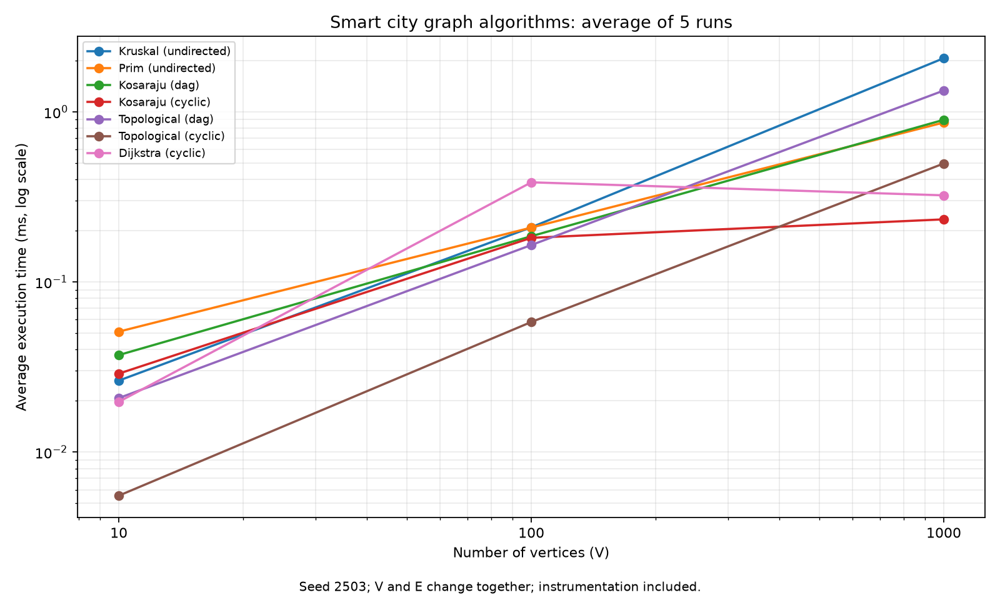
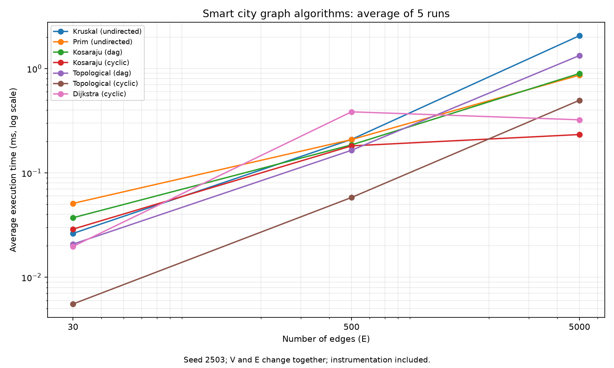

# Assignment 3: Smart City Infrastructure and Route Planning

**Student:** Khairgeldi Bekzat  
**Group:** SE-2503  
**Language:** Java 17

## Overview

The program represents city districts as vertices and roads as weighted edges. It finds a minimum-cost network, checks connectivity and finds shortest routes. The graph uses an edge list and adjacency lists. Undirected roads are stored in both directions in adjacency lists. Vertex IDs start at 0.

## How to run

Use JDK 17 or newer and Maven. Run from the project folder:

```text
mvn test
java -cp target/classes Main 0
java -cp target/classes Benchmark
```

The demo prints MST/forest edges and costs, SCCs, topological ordering, shortest distances and paths. Change `0` to select a source district from 0 to 5. District 5 is isolated to demonstrate unreachable vertices.

On Windows, with `JAVA_HOME` set to a JDK, these commands also work without Maven:

```powershell
powershell -ExecutionPolicy Bypass -File .\run.ps1 test
powershell -ExecutionPolicy Bypass -File .\run.ps1 demo -Source 0
powershell -ExecutionPolicy Bypass -File .\run.ps1 benchmark
```

To recreate the plots:

```text
python -m pip install -r requirements.txt
python scripts/plots.py
```

## Implementation

- **DSU:** path compression in `find` and union by size in `union`.
- **Kruskal:** sorts edges and uses DSU to avoid cycles.
- **Prim:** uses a priority queue of candidate edges. Both MST algorithms report connectivity and return a minimum spanning forest for disconnected graphs.
- **Kosaraju:** two DFS passes with a reversed graph to find SCCs.
- **Topological ordering:** Kahn's algorithm with indegrees and a queue. Reports a cycle if not all vertices can be processed.
- **Dijkstra:** priority queue and previous-vertex array for paths. Skips outdated queue entries, reports unreachable vertices and rejects negative weights.

The algorithm classes are in `src/graph`, `src/dsu`, `src/mst`, `src/connectivity` and `src/shortestpath`. `Main` runs the demo, `Benchmark` runs experiments, and `test/Tests.java` contains tests.

## Complexity Analysis

V is the number of vertices and E is the number of edges. The graph takes O(V + E) space. Java's priority queue is a binary heap; Prim and Dijkstra may keep multiple candidate entries.

| Algorithm | Time | Extra space |
| --- | --- | --- |
| DSU initialization | O(V) | O(V) |
| DSU find / union | O(alpha(V)) amortized | O(1) per call |
| Kruskal | O(V + E log(E + 1) + E alpha(V)) | O(V + E) |
| Prim | O(V + E log(E + 1)) | O(V + E) |
| Kosaraju | O(V + E) | O(V + E) |
| Topological ordering | O(V + E) | O(V) |
| Dijkstra | O(V + E log(E + 1)) | O(V + E) |

`alpha(V)` grows very slowly. Union by size keeps DSU trees shallow, while path compression makes later searches shorter. More vertices need larger arrays and more traversal work. More edges increase sorting and heap work, while SCC and topological ordering scan edges linearly.

Dijkstra needs non-negative weights because a negative edge can improve a distance after a vertex would normally be finalized. Bellman-Ford is an alternative for graphs with negative weights.

## Experimental Setup

| Size | V | E |
| --- | ---: | ---: |
| Small | 10 | 30 |
| Medium | 100 | 500 |
| Large | 1,000 | 5,000 |

Graphs use seed **2503**, weights from 1 to 100, no duplicate edges and no self-loops.

- Undirected graphs start with a random spanning tree, then extra edges are added. This guarantees connectivity for MST tests.
- DAG edges go from smaller to larger vertex IDs, preventing cycles.
- Cyclic directed graphs start with a ring through all vertices, then extra edges are added. They contain cycles and have one SCC. Dijkstra uses these graphs with source 0.

Each case has 20 warm-up runs and **5 measured runs**, using `System.nanoTime()`. Generation and file writing are outside the measurement; allocations and counters are included. The machine uses Windows 11 and OpenJDK 17.0.20.1, with 12 available processors.

## Results

Average execution time in milliseconds:

| Algorithm / graph | Small | Medium | Large |
| --- | ---: | ---: | ---: |
| Kruskal / undirected | 0.0263 | 0.2095 | 2.0664 |
| Prim / undirected | 0.0510 | 0.2086 | 0.8649 |
| Kosaraju / DAG | 0.0372 | 0.1856 | 0.8976 |
| Kosaraju / cyclic | 0.0289 | 0.1816 | 0.2332 |
| Topological / DAG | 0.0208 | 0.1647 | 1.3339 |
| Topological / cyclic | 0.0055 | 0.0581 | 0.4967 |
| Dijkstra / cyclic | 0.0197 | 0.3851 | 0.3228 |

Operation counts are shown as **small / medium / large**. Comparisons count sorting or heap comparator calls. Edge checks count algorithm scans, including reversal, indegree calculation or weight validation where needed.

| Algorithm / graph | Edge checks | Comparisons |
| --- | --- | --- |
| Kruskal / undirected | 13 / 225 / 4356 | 113 / 3814 / 50358 |
| Prim / undirected | 60 / 1000 / 10000 | 203 / 7544 / 111157 |
| Kosaraju / DAG | 90 / 1500 / 15000 | 0 |
| Kosaraju / cyclic | 90 / 1500 / 15000 | 0 |
| Topological / DAG | 60 / 1000 / 10000 | 0 |
| Topological / cyclic | 30 / 500 / 5000 | 0 |
| Dijkstra / cyclic | 60 / 1000 / 10000 | 32 / 1653 / 24223 |

Kruskal makes 13 / 225 / 4356 union calls and twice as many find calls. All counters are in [averages.csv](results/tables/averages.csv). The 105 individual measurements are in [raw.csv](results/tables/raw.csv).





Both plots use logarithmic scales. V and E increase together, so these are two views of the same experiments.

## Comparison and Discussion

Kruskal and Prim give equal MST weights on the tested connected graphs. Kruskal is faster for the small graph, their medium times are nearly equal, and Prim is faster for the large graph. Kruskal sorts all edges but stops checking once the tree is complete. Prim scans both directions and makes more heap comparisons. Comparison counts alone do not determine execution time.

Kosaraju's edge checks grow from 90 to 1,500 to 15,000, matching its linear complexity. Its large DAG takes longer than the cyclic graph, partly because the DAG produces many separate SCC lists.

Topological ordering succeeds on DAGs and detects cycles. The generated cyclic cases are faster because every vertex has an incoming ring edge, so Kahn's initial queue is empty.

Dijkstra's operation counts increase with graph size, although its large case runs slightly faster than the medium case. Short Java timings vary because of JVM warm-up, garbage collection and scheduling. Exact times will differ when experiments are rerun.

## Testing

All tests passed locally. Tests cover small and disconnected graphs, cycles, duplicate weights, multiple valid MSTs, unreachable vertices and a single vertex.

Checks include equal MST weights, acyclic forest edges, valid topological orders, correct cycle detection, one SCC membership per vertex, and correct shortest distances and paths. Random Dijkstra results are compared with test-only Bellman-Ford, small MSTs with exhaustive enumeration, and SCCs with mutual reachability.

GitHub Actions runs the build, tests, demo and benchmarks. Separate development branches and meaningful commits are kept in the repository.

## Conclusion

Kruskal and Prim are useful for minimum-cost infrastructure planning. Kosaraju finds mutually reachable districts, topological ordering handles dependencies without cycles, and Dijkstra finds shortest routes with non-negative distances.

